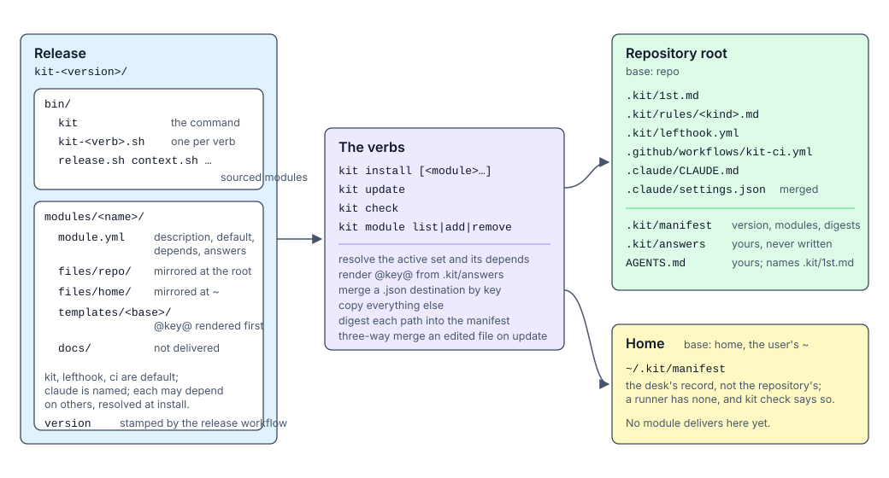
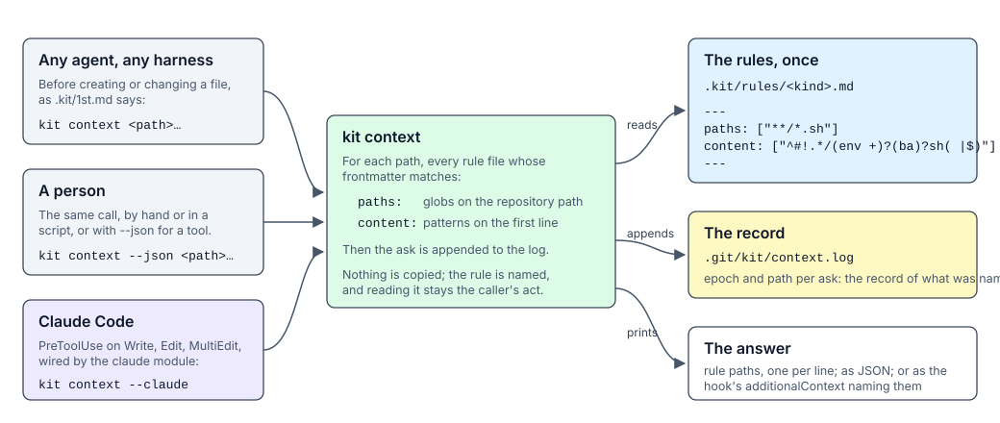
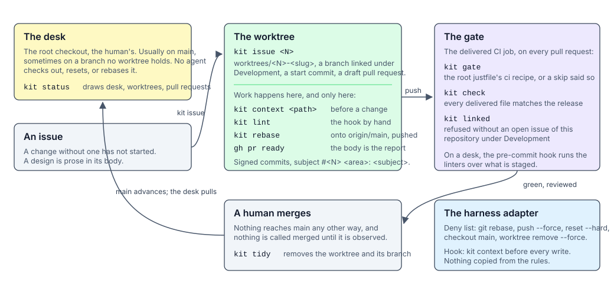

# Architecture

The kit is a release that a repository installs, a set of verbs an agent and a person both run, and the checks
that hold the work to the rules. This page is the shape of it: what a release is, how it reaches a repository, how
a file's rules are found, and how a change moves from an issue to `main`. [modules.md](modules.md) and
[context.md](context.md) are the two mechanisms in detail.

## The release and its delivery

A release is one tarball, `kit-<version>.tar.gz`, and its layout is the checkout's: `bin/` is the machinery, and
`modules/` is everything delivered. `bin/kit` is the command; each verb is an executable `bin/kit-<verb>.sh`
beside it, and the verbs share bash modules loaded with `use`. The release workflow stamps the tag's version into
a `version` file; a checkout has none and is `unreleased`.

A module is a directory under `modules/`, and the directory names it. `module.yml` describes it: whether it is active
by default, which modules it depends on, and the default answers for its templates; `files/<base>/` is mirrored at the
base's root; `templates/<base>/` is rendered first, every `@key@` replaced by an answer; `docs/` is packed with the
release and placed in no repository. Two bases exist: `repo`, the repository root, and `home`, the user's `~`.

The verbs are the only way content moves. `kit install` resolves the active set, `kit` plus those named plus their
dependencies, renders, places, and writes the manifests. `kit update` moves to a new pinned release:
an untouched file is replaced, an edited one three-way merged with the previous release as the base. `kit check`
fails when a delivered file differs from the release's. `kit module` changes the active set. Two rules govern
placement: a `.json` destination is merged by key, the kit owning only the entries it writes; everything else is a
copy.

Each base has a manifest: `.kit/manifest`, committed with the repository, and `~/.kit/manifest` on the desk when a
module delivers there. A manifest records the version, the active modules, and the release's digest of every
delivered path, which is how `kit update` tells an edited file from an untouched one.

## Finding a file's rules

A rule is written once, in `.kit/rules/<kind>.md`, and copied into no harness's directory. Its frontmatter says
what it governs: `paths:`, globs on the repository-relative path, and `content:`, patterns on the first line of a
file that exists. `kit context <path>` names the rules governing a path and appends the ask to
`.git/kit/context.log`. Every caller gets the same answer: an agent of any harness following the sentence in
`.kit/1st.md`, a person at the shell, a tool reading `--json`, and Claude Code's `PreToolUse` hook, which the
`claude` module wires to `kit context --claude` so the rules are named before every write. The call names and
never quotes: reading the rule stays an act the caller takes, and the log of asks is the record of what was
named.

## The loop and the gate

The desk is the root checkout and belongs to the human; it usually has `main` checked out and may have any branch no
worktree holds, and no agent changes it in place. Work starts from an issue: `kit issue <N>` makes
`worktrees/<N>-<slug>`, a branch linked to the issue under Development, a signed start commit, and a draft pull
request, and sweeps uncommitted work off the desk into the worktree, the one change it makes there, announced.
Everything after that happens in the worktree: `kit context` before a change, `kit lint` for the pre-commit linters by
hand, `kit rebase` to bring the branch onto `origin/main` and push it, and `gh pr ready` when the pull request body is
the report.

The gate is `kit ci`, three checks that are each one kit command, run by the delivered GitHub Actions job for a
pull request into the default branch, or by any pipeline. `kit gate` runs the repository's gate, the `gate`
setting or the detected justfile recipe, Makefile target, or package.json script, and refuses when there is none,
since a gate that cannot run clears nothing. `kit check` holds the delivered files to
the release. `kit linked` refuses a pull request not linked to an open issue of the repository. A human merges, and
`kit tidy` removes the worktree and the branch afterwards. `kit status` draws the whole picture: the desk, every
worktree with its commits past the fork, and every open pull request with its state, age, and checks.

## What verifies what

| Claim | Held by |
| --- | --- |
| A delivered file is the release's | `kit check`, in the gate and on a desk, against the release's files and the manifest's version |
| A change has an issue | `kit linked` in the gate; `kit issue` makes the link when it starts the work |
| The repository's own gate ran | `kit gate`, which refuses when there is no gate to run |
| All three held, wherever CI runs | `kit ci`, the three checks as one verb, every one reported |
| A file's rules were named to the agent | the Claude Code hook; `kit context` in every other harness |
| A file's rules were asked for | `.git/kit/context.log`, one line per ask |
| The forbidden spellings were not used | the harness's deny list, delivered by its adapter module |
| The desk was not disturbed | `kit rebase` refusing the root checkout; `kit issue` never switching its branch |

No check holds whether a rule, once read, was followed. The linters hold the mechanical part of that for the kinds
they cover; the rest is the pull request body's report, which the integrity rules in `.kit/1st.md` bind.
