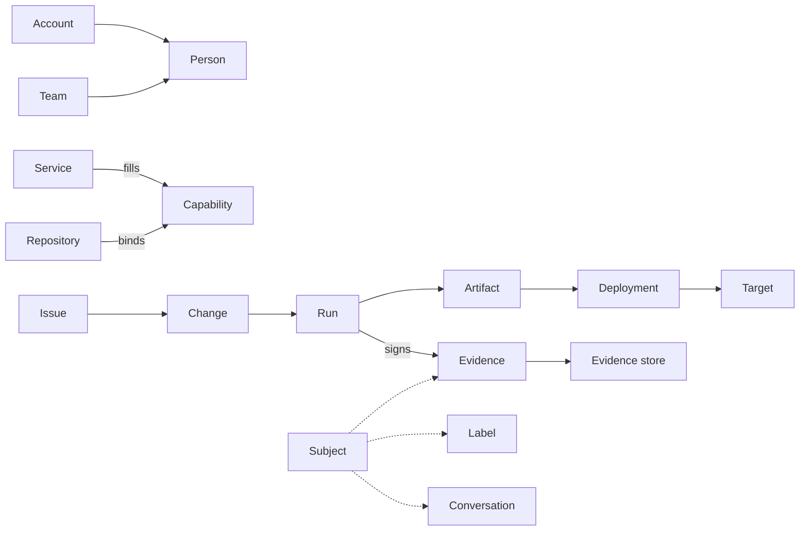

# Entities: design

Status: proposed, 2026-11-09.

## Intent

kit's entities are the things it names, reads, links, and checks: a repository, an issue, a person, a build, an
artifact, a setting. kit knows some of them today: the code forge, trackers, toolchains, workspaces, git's own
entities, policies, and packages. Each arrived with the feature that needed it, so each has its own words, its own
settings key, and its own place on disk. The work kit governs runs on more than that: pipelines that deploy, stores
that keep what was built, the evidence that it was checked, the people and teams who did it, and the conversations
where they talk about it.

This document names every entity kit needs, groups them into domains, says how they relate, and says where each
one's configuration lives. Little of it belongs in the first release. It is written now to find the simplifications
that change what the first release builds, while changing it is still cheap; [Simplifications](#simplifications)
lists them, and [What the first release settles](#what-the-first-release-settles) says which ones land early.

## Goals

- One name per entity, used by the CLI, kittui, the settings, the MCP server, and the docs.
- A model of the delivery chain from issue to running software, so kit can answer "where did this come from, and was
  it checked?" for any commit, artifact, or deployment, with evidence no desk could have forged.
- Services described by what they do, so a forge that also tracks issues, runs CI, and stores packages is one service
  filling several capabilities, and a repository can move one capability to another service without touching the
  rest.
- One way to say which repositories a value reaches: all of them, a selection, or one.
- One person behind many accounts, resolved by the organization's own directory, whatever it is.
- Conversations that follow the work: a thread about an issue or a change reads the same in the forge and in chat,
  either side can answer, and the thread carries the subject's labels.
- Tracker concepts kit can rely on, such as an iteration or a priority, mapped onto each tracker's own way of
  holding them, including by convention where the tracker has no field for them.

## Non-goals

- kit becoming a tracker, a CI system, an artifact store, a chat service, or a deployment tool. kit reads these
  systems, links what they hold, and checks it.
- A database of kit's own. What kit needs to remember about the platform it keeps in the services themselves; see
  [Simplifications](#simplifications).
- Storing credentials. A service's own CLI or credential helper holds them, as `gh`, `glab`, and `az` do today.
- Building every domain in the first release.

## Anti-goals

- A mapping that guesses. When an issue carries two sprint labels, kit reports the conflict; it never picks one.
- A preference that changes a verdict. Nothing a person sets for themselves can make a check pass that the shared
  settings fail.
- Evidence signed on a desk. A developer's machine can be changed by its developer, so nothing it signs proves
  anything to anyone else.
- A model that needs configuring before it works. Every entity kit can infer, it infers: the forge from the remote,
  the caller from the service's CLI, and a service's capabilities from its provider. Configuration only overrides.
- Personal data kit does not need. kit asks the directory for a person when it needs one, and keeps no copy.

## Terms

The platform, or the stack, is the set of services a repository's work runs on. Its parts are services, each filling
capabilities. kit already says toolchain for a tool manager: mise, nix, Homebrew, a Docker image, a dev container, or
a system package manager ([toolchains.md](../../toolchains.md)), and `kit toolchains` ships under that name, so
toolchain keeps that meaning.

A subject is anything kit can name with a reference: a repository, an issue, a change, a commit, a run, an artifact,
a release, or a deployment. Labels, conversations, events, and evidence are all about a subject.

## The domains

| Domain | What it covers | Entities |
| --- | --- | --- |
| [Actors](#actors) | who does the work | Person, Agent, Bot, Account, Team, Role |
| [Platform](#platform) | the systems kit talks to | Service, Capability, Binding, Provider |
| [Code](#code) | what git and the forge hold | Workspace, Repository, Remote, Checkout, Worktree, Branch, Commit, Tag, Change, Review |
| [Work](#work) | what is planned and tracked | Tracker, Issue, Mapping, Iteration, Milestone, Board, Label, and the work fields |
| [Delivery](#delivery) | what is built, released, and run | Pipeline, Run, Check, Gate, Release, Artifact, Artifact store, Environment, Deployment, Target, Fleet |
| [Trust](#trust) | what shows the work can be trusted | Evidence, Finding, Evidence store, Policy, Rule, Control, Waiver, Approval |
| [Tools](#tools) | what runs on a desk and in CI | Tool, Tool catalog, Toolchain, Dependency manager |
| [Configuration](#configuration) | who decides what, for which repositories | Owner, Reach, Selection, Setting, Preference, Answer, Local state |
| [Conversation](#conversation) | where people talk about the work | Conversation, Message, Channel, Event, Route |
| [kit's content](#kits-content) | what a release delivers | Release, Source, Package, Bundle, Kind, Rule file, Style, Template, Region |



## Simplifications

Thinking the whole model through leaves five ideas that each replace several special cases.

1. Everything is a subject, named by a reference. kit has references for issues, `#7` and `AB#4521`, and names for
   members, `github.com/empowerite/kit`. Extended to every subject, `github.com/empowerite/kit#7`, `…!3` for a change,
   `…@<sha>` for a commit, `sha256:…` for an artifact, one syntax addresses everything. Labels, conversations,
   events, evidence, and kittui's links between rows then need no type of their own per subject.
2. One selector says which repositories something reaches: all, a selection, or one. A selection is a workspace by
   name, or the selectors workspaces already have: an owner, a topic, a name pattern. Configuration, chat routes,
   tool catalogs, and policies all reach repositories this way, so there is one language for "which repositories",
   not four.
3. Every capability is a seam, and every seam takes a command provider. kit's five seams each have a contract: the
   calls a provider answers, as [trackers.md](../../trackers.md) lists the tracker's. A command provider is an
   executable the organization supplies, in any language, that answers the same calls with JSON. Teams, an internal
   deployment tool, or a homegrown evidence store then need no code in kit. A capability kit has no provider for yet
   is a contract and a command away.
4. kit keeps no state of its own about the platform. A binding between a chat thread and an issue lives in the
   thread's message metadata and a link comment on the issue; evidence lives in the evidence store; teams live in
   the directory. kit stays a stateless reader and linker, with nothing to back up, migrate, or keep in sync.
5. Evidence is one thing: a signed statement made in CI about a subject. Signed by the CI run's own identity and
   shipped out of the platform, it is evidence. The same check run anywhere else is a finding: the same output,
   advisory, never evidence. Attestation, provenance, SBOM, test report, and kit's verdict become kinds of one
   statement, in one format.

## Actors

An actor is anything that acts: it opens an issue, pushes a commit, approves a change, or runs a deployment.

| Entity | What it is | Holds | Today |
| --- | --- | --- | --- |
| Person | a human, known by one handle across every service | handle, display name; accounts come from the directory | not modelled; each service's login stands in |
| Agent | a harness session acting for a person: a Claude Code session, a Codex run | harness, the person it acts for, its worktree | harness adapters in [context.md](../../context.md) |
| Bot | a service account that acts for no person: Dependabot, a release bot | its account on each service | `linked_exempt` names bots by login |
| Account | an actor's identity on one service | service, login or id | the tracker call `me`; git's `user.name`, `user.email`, and `user.signingkey` |
| Team | a named group of people | handle, members, its counterpart on each service | not modelled |
| Role | what an actor may do in a repository or environment | name, the service's own role it maps to | not modelled; the forge enforces its own |

Teams and people come through the identity capability, a seam like the tracker's. kit stores no directory. The
organization's own system answers, through a provider:

| Call | Prints |
| --- | --- |
| `person <service> <account>` | the handle of the person who owns that account, or nothing |
| `accounts <handle>` | the person's accounts, by service |
| `teams [<handle>]` | every team, or the teams the person is on |
| `members <team>` | the team's members, by handle |

- Providers: the forge's own teams, GitHub teams or GitLab groups, for an organization that keeps people there; and a
  command, the organization's tool over its directory, an identity provider, or a file it keeps.
- Git counts as a service, and a person's git identity, the name, email, and signing key on their commits, is one of
  their accounts. The directory then names the person behind a commit.
- An agent always acts for a person. Evidence of an agent's act names both, so "who did this" never ends at a session
  id.
- The caller is the account the service's CLI is signed in as, then the person the directory says owns it.

```yaml
services:
  directory: {provider: command, run: tools/directory}
bind:
  identity: directory
```

## Platform

A service is one system kit talks to: github.com, a self-hosted GitLab, an Azure DevOps organization, a Slack
workspace, a container registry. A capability is a job a service does, and each capability is a seam. A binding says
which service fills a capability for a repository. A provider is kit's code, or an organization's command, that speaks
to one kind of service ([architecture.md](../../architecture.md#code-forges-seams-and-providers)).

| Capability | What the service does | Seam today |
| --- | --- | --- |
| hosting | holds the repository and its remotes | `forge.sh` |
| review | holds changes, their reviews, and their approvals | `forge.sh` |
| tracking | holds issues, their iterations, milestones, and boards | `tracker.sh` |
| ci | runs pipelines on changes and branches | `forge.sh`, for runs and checks |
| cd | deploys to environments and records deployments | none |
| releases | publishes releases and their notes | `forge.sh`, for releases |
| artifacts | stores built artifacts by digest: packages, images, release assets | none |
| evidence | stores signed evidence outside the platform that made it | none |
| identity | resolves accounts to people, and holds teams | none |
| chat | carries conversations, both ways | none |

The forge seam fills hosting, review, ci, and releases together, and stays one seam until a repository needs one of
them from another service. Planning folds into tracking: an iteration is a field of an issue and an entity of the
tracker that holds it.

| Service | hosting | review | tracking | ci | cd | releases | artifacts | evidence | identity | chat |
| --- | --- | --- | --- | --- | --- | --- | --- | --- | --- | --- |
| GitHub | yes | yes | yes, with Projects | Actions | environments | yes | Packages, GHCR, assets | artifact attestations | orgs, teams | comments |
| GitLab | yes | yes | yes, with iterations | CI/CD | environments | yes | package and container registries | no | groups | comments |
| Azure DevOps | Repos | Repos | Boards | Pipelines | environments | no | Artifacts | no | teams | comments |
| Jira, Linear | no | no | yes, with sprints or cycles | no | no | no | no | no | users | comments |
| Slack | no | no | no | no | no | no | no | no | users | yes |

Bindings are inferred first. The primary remote's host names the forge, as it does today, and the forge fills every
capability its provider can. A repository overrides a capability only where it differs. The existing keys stay as
the short form: `forge` and `forges` bind the forge's capabilities, and `trackers` binds tracking by reference prefix.
The shape below is illustrative; its exact keys are the builder's.

```yaml
services:
  ado: {provider: ado, organization: https://dev.azure.com/example, project: Claims}
  evidence: {provider: oci, host: registry.example.com, repository: evidence}
  slack: {provider: slack, workspace: example}
bind:
  evidence: evidence
  chat: slack
```

- A capability bound to no service is absent, and a verb that needs it says which capability is missing.
- Each member of a workspace keeps its own bindings, as each keeps its own `kit.yml` under `kit flow --workspace`.
- `kit platform` lists each capability, the service filling it, whether that was inferred or set, and whether the
  service's CLI is signed in.

## Code

These entities exist in kit today, through git and the forge seam, and keep their meaning. See
[workspaces.md](../../workspaces.md).

| Entity | What it is | Reference | Today |
| --- | --- | --- | --- |
| Workspace | one repository, or a named group of them | its name | `kit workspaces` |
| Repository | a member, named by host and path | `github.com/empowerite/kit` | `kit workspace repos` |
| Remote | a repository's named URL, with its forge | the repository's, and the remote's name | `kit workspace remotes` |
| Checkout | a clone on this machine; the desk is its main worktree | a path | `kit workspace repos` |
| Worktree | a linked worktree of a checkout, one per issue | a path | `kit work`, `kit workspace worktrees` |
| Branch | a branch on a remote or local, with its upstream | the repository's, and the branch | `kit workspace branches` |
| Commit | a commit, with its issue, signature, and author | `…@<sha>` | `kit workspace commits` |
| Tag | a tag, annotated or lightweight | the repository's, and the tag | `kit workspace tags` |
| Change | a pull request or merge request, in the forge's own word | `…#3` on GitHub, `…!3` on GitLab | `kit flow changes` |
| Review | an approval, a request for changes, or a thread on a change | the change's | forge seam: review threads |

A signed commit proves who wrote it, not that it was checked: commit signing stays an authorship rule, apart from
[Trust](#trust).

## Work

A tracker is a service filling the tracking capability; [trackers.md](../../trackers.md) holds what exists. An issue
is one item in a tracker, named by a reference whose prefix picks the tracker.

kit reads and writes issues through a fixed set of work fields. Each tracker holds some of them natively. The rest
it holds by convention, which a mapping declares.

| Field | Meaning | GitHub | GitLab | Azure Boards | Jira |
| --- | --- | --- | --- | --- | --- |
| type | bug, feature, task, epic | issue types, else a label | labels, epics | work item type | issue type |
| state | open, in progress, closed, and the reason | open or closed, with a reason | opened or closed | state | status |
| assignees | the accounts responsible | native | native | assigned to, one | assignee, one |
| parent | the issue it is part of | sub-issues | epics, linked items | parent link | parent |
| iteration | the sprint or cycle it is planned in | a Projects iteration field, else a label | iterations | iteration path | sprint |
| milestone | the release or deadline it targets | milestones | milestones | a tag, else an iteration | fix version |
| priority | how urgent it is | a Projects field, else a label | labels | priority | priority |
| estimate | how big it is | a Projects field, else a label | weight | story points | story points |
| labels | free tags | native | native | tags | labels |
| board | the board or project it is on, and its column | Projects | boards | boards | boards |

A mapping says, per tracker and per field, where the value lives:

- `native`: the tracker's own field, the default wherever one exists.
- `field`: a custom field, such as a GitHub Projects field, named with its project.
- `label`: a label with a pattern, `sprint/{name}` or `P{value}`, the value read from the label's name.
- `milestone`: the tracker's milestone stands for the field, as when a team runs sprints as milestones.

```yaml
trackers:
  - prefix: "#"
    provider: forge
    map:
      iteration: {label: "sprint/{name}", cadence: {first: 2026-11-02, weeks: 2, name: "{year}-{week}"}}
      priority: {label: "P{value}", values: ["0", "1", "2", "3"]}
      estimate: {field: Estimate, project: empowerite/3}
```

- kit reads and writes through the mapping, so a kittui column named Iteration shows the same thing on every
  tracker, and `kit work` can set it.
- An emulated iteration has a name and no dates, so its mapping declares a cadence: the first iteration's start, its
  length, and its name pattern. kit computes the current iteration from it.
- A value that breaks the mapping is a finding, never a guess: two iteration labels, a priority outside its values, a
  label for an iteration the cadence does not produce.
- Mappings are shared settings. Everyone who reads the tracker must read it the same way.

Labels are the forge's, and belong to a subject. Through conversations, a chat thread takes the labels of its
subject; see [Conversation](#conversation).

## Delivery

| Entity | What it is | Holds | Today |
| --- | --- | --- | --- |
| Pipeline | a CI or CD definition in the repository | its file, the events that start it | the delivered `kit-ci.yml` |
| Run | one execution of a pipeline | pipeline, commit, change, actor, status, its jobs, its logs, its identity | `kit flow builds` |
| Check | a named result reported on a commit or change | name, status, the run that reported it | the forge seam's checks; `kit ci`'s four |
| Gate | the repository's own CI command | the `gate` setting | `kit gate` |
| Release | a version published from a tag | tag, notes, artifacts | `kit release`, `kit flow releases` |
| Artifact | an output of a run, named by its digest | digest, name, media type, the run that built it | the release tarball |
| Artifact store | where artifacts are kept | service, location, retention | GitHub release assets |
| Environment | a named place software is deployed to, as development, staging, or production | name, its protection: required checks, approvers, branch limits | not modelled |
| Deployment | an artifact deployed to an environment | artifact digest, environment, run, actor, time, status | not modelled |
| Target | one concrete place an environment runs on: a cluster's namespace, a host, a function, a store listing | environment, address, what it runs now | not modelled |
| Fleet | the targets of one environment taken together | environment, targets, the version each runs | not modelled |

- An artifact is identified by its digest, never by its name or tag, because a tag can move.
- A deployment names the artifact's digest, so the chain from a running target back to its commit holds.
- A fleet makes drift visible: the targets of one environment running different versions.
- kit reads environments and deployments from the service filling cd, or from a command provider over an
  organization's own deployment tool.

## Trust

Evidence is made only in CI, by a run whose identity the CI service vouches for, and it leaves the platform that
made it. A desk runs the same checks and gets findings: the same output, advisory, unsigned, never evidence.

| Entity | What it is | Holds |
| --- | --- | --- |
| Evidence | a signed statement, made by a CI run, about a subject | the subject's digest, its kind, the statement, the run's identity, kit's version and the policy's, the time |
| Finding | a check's result anywhere evidence cannot be made: a desk, an agent's session, a fork's run | the same as evidence, unsigned |
| Evidence store | where evidence is kept, outside the platform that made it | service, location, retention, how it is verified |
| Policy | the patterns or Open Policy Agent rules a change must meet | its engine, its rules, its version |
| Rule | one requirement in a policy | an id, what it checks |
| Control | an obligation from outside kit, such as "every production change is reviewed by someone other than its author" | its id, its source standard, the kinds of evidence that satisfy it |
| Waiver | a recorded exception to a rule or control | what it waives, for whom, why, who granted it, and until when |
| Approval | an actor's consent to a change or a deployment | actor, subject, time |

- One format: an in-toto statement in a signed envelope. Its kinds are kit's verdict, build provenance, test results,
  and a bill of materials. Its subject is an artifact's digest, or a commit by its hash.
- The signer is the run's workload identity, the token the CI service issues to a job (OpenID Connect), with a
  short-lived certificate from it, so no long-lived key exists to steal. The identity names the repository, the
  pipeline, and the ref, and verification checks all three.
- A run of a fork's change or of an unprotected branch makes findings, not evidence: its identity proves less.
- Shipping is a seam, the evidence capability. Providers: an OCI registry, which keeps evidence beside the artifact;
  a transparency log; object storage with a retention lock; the forge's own attestations, where the forge is trusted
  to keep them; and a command.
- `kit verify <subject>` fetches the subject's evidence from the store, checks each signature and signer, and says
  which controls it satisfies. It trusts the CI identity and the store, never the machine it runs on.
- Provenance is the chain: issue, branch, signed commits, change, reviews and approvals, run, evidence, artifact,
  release, deployment, target. From a deployed digest, kit names the issues, the reviewers, the checks, and the
  policy version; from an issue, where its code runs now.
- A control is met when the store holds evidence of the right kind for every subject in its scope.
- A waiver always has an expiry, except a bot's, and kit reports one about to lapse.

## Tools

A tool is a program the work runs on a desk or in CI: `gh`, `jq`, `opa`, `markdownlint-cli2`. A toolchain installs
and pins tools, and a dependency manager pins a language's packages on top; both exist, in
[toolchains.md](../../toolchains.md). What is new is the catalog of approved tools.

| Entity | What it is | Holds | Today |
| --- | --- | --- | --- |
| Tool | a program the work runs | name, version, where it resolves | `kit tools` |
| Tool catalog | the tools an organization approves | for each tool: name, allowed versions, where each toolchain installs it from, its checksum or digest, why it is approved | not modelled |
| Toolchain | a tool manager: mise, nix, Homebrew, Docker, a dev container, or a system package manager | its role, project or system | `kit toolchains` |
| Dependency manager | npm or uv, pinning packages from a lock file | its manifest and lock | `kit tools`, the dependencies seam |

- A catalog is a shared setting, delivered as a source package pinned by digest, and reaches repositories by
  selector: all of an organization's, or a selection.
- `kit tools install` installs what the chosen toolchain pins. With a catalog, `kit check` also reports a pinned tool
  the catalog does not approve, or a version outside its range.

## Configuration

A value has an owner, who decides it, and a reach, the repositories it applies to.

| Owner | all | selected | one repository |
| --- | --- | --- | --- |
| organization | a source package | a source package, by selector | not used: a repository's own file decides |
| person | `~/.config/kit/`, under `all` | `~/.config/kit/`, under a selection | `~/.config/kit/`, under the repository, never checked in |
| repository | not used | not used | `kit.yml` and `.kit/`, checked in with the code: shared |

A selection is a workspace by name, or a selector: an owner, a topic, a name pattern. The workspace file keeps holding
only membership; configuration names a workspace, and never lives inside one.

```yaml
# ~/.config/kit/config.yml
all:
  kittui: {theme: dark}
selected:
  - repos: {workspace: empowerite}
    flow: {stages: [backlog, underway, changes, builds]}
  - repos: {owner: github.com/acme, topic: payments}
    toolchain: nix
```

- A setting decides what kit enforces or what a verdict is. It comes only from the repository and the organization,
  the owners whose files are reviewed and pinned. A repository can tighten an organization's setting, never loosen
  it, unless the organization marks it open to override.
- A preference decides what a person sees or which default they get. Any owner may set it. The narrower reach wins,
  and at the same reach the person wins over the repository, and the repository over the organization.
- An answer is a value a package's templates use, and a setting.
- Each key declares in the schema whether it is a setting or a preference, so a misplaced key is refused where it is
  read.
- Local state is not configuration: a clone's or a worktree's toolchain choice, caches, logs, and the last workspace
  used. It stays in the git directory, `~/.cache/kit/`, and `.kit/logs/`, and nothing reads it as a decision.
- `kit config <key>` shows a key's value, which owner and reach it came from, and every other that tried to set it.

## Conversation

A conversation is a thread about a subject, whose messages live in one or more services: the comments on an issue or
a change in the forge, and a thread in Slack. Either side can answer, and kit carries each message to the other.

| Entity | What it is | Holds |
| --- | --- | --- |
| Conversation | a thread about one subject, mirrored across services | subject, the thread in each service |
| Message | one post in a conversation | author, as a person; the service it was written in; its mirrors |
| Channel | a place in a chat service that conversations happen in | service, address, the reach and subject kinds it takes |
| Event | something about a subject worth telling: a change ready for review, a run failed, a release published, a deployment finished, a waiver about to lapse | kind, subject, actor, time |
| Route | which events go to which channel | event kinds, labels, reach, channel |

- Scope is the subject's kind: a channel takes a repository or a selection, and a thread in it takes one issue,
  change, run, release, or deployment. An event about a subject goes to its conversation's thread, or starts one.
- Slack keeps no labels on a thread. A conversation's labels are its subject's, held by the forge. kit records the
  subject in the Slack message's metadata, so a route, a search, or a filter by label resolves through the subject,
  and a label added on the forge reaches the thread with no change in Slack.
- A thread started in Slack about no subject gets one when someone promotes it: kit opens an issue from the thread,
  and the thread is bound to it from then on.
- Authors are people: the identity capability maps a Slack account and a forge account to one handle, so a mirrored
  message names its author in each service's own terms.
- Two-way chat needs something always listening for both services' events. It is the first part of kit that is not a
  command: a relay, run by the organization, that a webhook from each side calls. Where the forge's own chat
  integration covers a route, kit configures it instead of relaying.

## kit's content

These entities exist and keep their meaning; [packages.md](../../packages.md) and
[architecture.md](../../architecture.md) define them.

| Entity | What it is |
| --- | --- |
| Release | a kit version, one tarball |
| Source | another release a repository takes packages from, pinned by digest |
| Package | a unit of delivered content: files, rules, templates, and settings |
| Bundle | a package of packages |
| Kind | a type of file, by path glob and first line |
| Rule file | what the work must do for a kind of file to be trusted |
| Style | how a kind of file looks |
| Template | a shape a file of a kind can take |
| Region | a delimited part of a file that kit owns |

## What the first release settles

None of the new domains ships in the first release. Four decisions cost little now and much later, because verbs,
files, and kittui already depend on them:

1. References. Settle the full reference for every subject, and have kittui's links between rows, `kit flow --json`,
   and `kit workspace --json` carry it, before more of them invent their own.
2. Owner and reach. Lay out `~/.config/kit/` for `all`, `selected`, and one repository, and mark each existing key as
   a setting or a preference, before more person files appear beside `kittui.json` and `presets.json`. The system
   toolchain's `~/.kit/settings.yml` moves there.
3. The command provider. Write each existing seam's contract down as JSON in and out, as trackers.md does for the
   tracker's, so a command provider is possible for every seam the day one is needed.
4. A verdict a CI run can sign. `kit ci --json` prints its verdict as an unsigned in-toto statement. The first
   release ships no signing and no store, and the statement's shape is fixed for when it does.

## The order of the work after it

1. Trust: signing in CI, an evidence store, and `kit verify`.
2. Identity: the seam, its forge and command providers, and a person shown for a commit's author.
3. Work: mappings for iteration, priority, and estimate, with the cadence; the fields in kittui.
4. Platform: services and bindings beyond the forge and trackers; `kit platform` and `kit config`.
5. Delivery: environments and deployments read from the cd service, with the provenance chain.
6. Tools: the catalog.
7. Conversation: one-way routes first, then the relay for two-way threads.
8. Fleet: targets and drift.

## My calls

- Platform is the word, with stack as its synonym; toolchain keeps its shipped meaning.
- The forge stays one seam until a repository needs one of its capabilities elsewhere, and planning folds into
  tracking.
- The existing keys `forge`, `forges`, and `trackers` stay as the short form of bindings.
- Git counts as a service, and a person's git identity as one of their accounts.
- An agent always acts for a person, and evidence names both.
- The workspace file keeps holding only membership; configuration refers to workspaces by name.
- At the same reach, a person's preference wins over the repository's.
- A fork's run or an unprotected branch's run makes findings, not evidence.
- Fleet comes last.

## Open questions

1. Which evidence store, and how long evidence must be kept. Compliance retention decides between a registry beside
   the artifacts, a transparency log, and storage of the organization's own.
2. Who runs the chat relay, and where: a service the organization hosts, a serverless function, or the forge's own
   app platform.
3. Whether the organization's settings reach repositories by selector through a source package, or through a
   repository of the organization's read at its head.
4. Which work fields matter first, beyond iteration.
