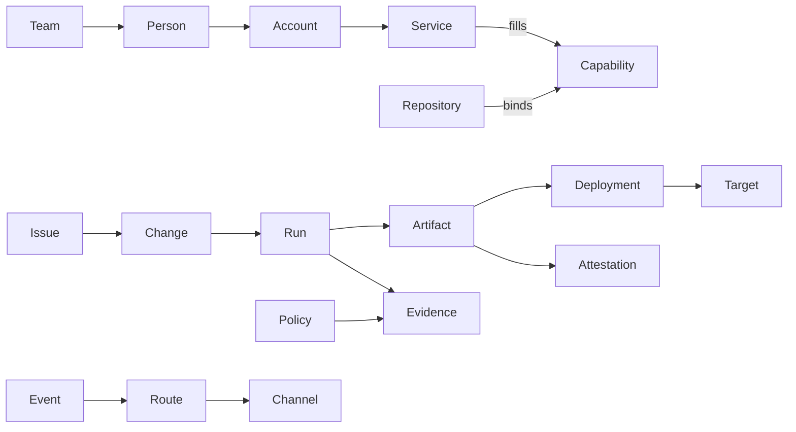

# Entities: design

Status: proposed, 2026-11-09.

## Intent

kit's entities are the things it names, reads, links, and checks: a repository, an issue, a person, a build, an
artifact, a setting. kit knows some of them today: the code forge, trackers, toolchains, workspaces, git's own
entities, policies, and packages. Each arrived with the feature that needed it, so each has its own words, its own
settings key, and its own place on disk. The work kit governs runs on more than that: pipelines that deploy, stores
that keep what was built, the evidence that it was checked, the people and teams who did it, and the channels where
they hear about it.

This document names every entity kit needs, groups them into domains, says how they relate, and says where each
one's configuration lives. kit's verbs, kittui's fields, `kit.yml`'s keys, and `kit serve`'s tools then share one
vocabulary. A command, a column, and a setting about the same thing use the same word.

## Goals

- One name per entity, used by the CLI, kittui, the settings, the MCP server, and the docs.
- A model of the delivery chain from issue to running software, so kit can answer "where did this come from, and was
  it checked?" for any commit, artifact, or deployment.
- Services described by what they do, so a forge that also tracks issues, runs CI, and stores packages is one service
  filling several roles, and a repository can move one role to another service without touching the rest.
- One ladder of configuration scopes, from the organization to a single run, with a rule for which scopes may set
  what.
- One person behind many accounts: the same name for a teammate on GitHub, GitLab, Azure DevOps, Slack, and in git.
- Tracker concepts kit can rely on, such as an iteration or a priority, mapped onto each tracker's own way of
  holding them, including by convention where the tracker has no field for them.

## Non-goals

- kit becoming a tracker, a CI system, an artifact store, a chat bot, or a deployment tool. kit reads these systems,
  links what they hold, and checks it. It writes to them only through the verbs that already do: assign, close,
  comment, create, and the like.
- Storing credentials. A service's own CLI or credential helper holds them, as `gh`, `glab`, and `az` do today.
- Building every domain at once. [The order of the work](#the-order-of-the-work) puts them in sequence.

## Anti-goals

- A mapping that guesses. When an issue carries two sprint labels, kit reports the conflict; it never picks one.
- A preference that changes a verdict. Nothing a person sets for themselves can make a check pass that the shared
  settings fail.
- A model that needs configuring before it works. Every entity kit can infer, it infers: the forge from the remote,
  the caller from the service's CLI, and a service's capabilities from its provider. Configuration only overrides.
- Personal data kit does not need. A person's record holds a handle, a display name, and account names, and no more.

## Terms that clash

kit already says toolchain for a tool manager: mise, nix, Homebrew, a Docker image, a dev container, or a system
package manager ([toolchains.md](../../toolchains.md)). The `kit toolchains` verb ships under that name. The wider
sense, the set of services a repository's work runs on, is called the platform here. Its parts are services, each
filling capabilities. This is my call: the shipped word keeps its meaning, and the new concept takes a new word.

## The domains

| Domain | What it covers | Entities |
| --- | --- | --- |
| [Actors](#actors) | who does the work | Person, Agent, Bot, Account, Team, Role |
| [Platform](#platform) | the systems kit talks to | Service, Capability, Binding, Provider |
| [Code](#code) | what git and the forge hold | Workspace, Repository, Remote, Checkout, Worktree, Branch, Commit, Tag, Change, Review |
| [Work](#work) | what is planned and tracked | Tracker, Issue, Reference, Mapping, Iteration, Milestone, Board, and the work fields |
| [Delivery](#delivery) | what is built, released, and run | Pipeline, Run, Check, Gate, Release, Artifact, Artifact store, Environment, Deployment, Target, Fleet |
| [Trust](#trust) | what shows the work can be trusted | Evidence, Evidence store, Attestation, Policy, Rule, Control, Waiver, Approval |
| [Tools](#tools) | what runs on a desk and in CI | Tool, Tool catalog, Toolchain, Dependency manager |
| [Configuration](#configuration) | who decides what | Scope, Setting, Preference, Answer |
| [Communication](#communication) | who hears about it | Channel, Event, Route |
| [kit's content](#kits-content) | what a release delivers | Release, Source, Package, Bundle, Kind, Rule file, Style, Template, Region |



## Actors

An actor is anything that acts: it opens an issue, pushes a commit, approves a change, or runs a deployment. Evidence
records the actor of every act.

| Entity | What it is | Holds | Today |
| --- | --- | --- | --- |
| Person | a human, known to kit by one handle across every service | handle, display name, accounts | not modelled; each service's login stands in |
| Agent | a harness session acting for a person: a Claude Code session, a Codex run | harness, the person it acts for, its worktree | harness adapters in [context.md](../../context.md); sessions coordinate by hand |
| Bot | a service account that acts for no person: Dependabot, a release bot | its account on each service | `linked_exempt` names bots by login |
| Account | an actor's identity on one service | service, login or id | the tracker call `me`; git's `user.name`, `user.email`, and `user.signingkey` |
| Team | a named group of people | handle, members, its counterpart on each service | not modelled |
| Role | what an actor may do in a repository or environment | name, the service's own role it maps to | not modelled; the forge enforces its own |

- Git is a service like any other here: a person's git identity, the name, email, and signing key on their commits,
  is one of their accounts. kit can then name the person behind a commit.
- An agent always acts for a person. Evidence of an agent's act names both, so "who did this" never ends at a
  session id.
- A team's members come from the service that has teams, when there is one: a GitHub team, a GitLab group, an Azure
  DevOps team. kit stores only what no service holds: which person each account belongs to, and which team on each
  service is the same team. A team defined in kit alone is for a service with no teams of its own.
- The caller is resolved once per run: the account the service's CLI is signed in as, then the person who owns it.
  `kit work` assigns the person's account on whichever tracker the issue lives in, as it does today with `me`.

The directory of people and teams is shared, because everyone must resolve a name the same way. It holds a handle
per person, so `@jaguilera` means the same person in a commit trailer, a review, and a Slack message.

```yaml
people:
  jaguilera:
    name: Jeffrey Aguilera
    accounts: {github: jeffrey-aguilera, git: jeffrey@example.com, slack: U02ABC}
teams:
  core:
    members: [jaguilera]
    on: {github: empowerite/core}
```

Where the directory lives is an open question; see [Open questions](#open-questions).

## Platform

A service is one system kit talks to: github.com, a self-hosted GitLab, an Azure DevOps organization, a Slack
workspace, a container registry. A capability is a job a service does. A binding says which service fills a
capability for a repository. A provider is kit's code that speaks to one kind of service, a seam's provider as in
[architecture.md](../../architecture.md#code-forges-seams-and-providers).

| Capability | What the service does | Seam today |
| --- | --- | --- |
| hosting | holds the repository and its remotes | `forge.sh` |
| review | holds changes, their reviews, and their approvals | `forge.sh` |
| tracking | holds issues | `tracker.sh` |
| planning | holds iterations, milestones, and boards | none |
| ci | runs pipelines on changes and branches | `forge.sh`, for runs and checks |
| cd | deploys to environments and records deployments | none |
| releases | publishes releases and their notes | `forge.sh`, for releases |
| artifacts | stores built artifacts by digest: packages, images, release assets | none |
| evidence | stores attestations and check results durably | none |
| identity | holds accounts, teams, and roles | none |
| chat | carries messages to channels | none |
| secrets | holds secret values that pipelines and deployments read | none; kit never reads a value |

One service usually fills several capabilities. The table is what each provider can fill, not what a repository
binds.

| Service | hosting | review | tracking | planning | ci | cd | releases | artifacts | evidence | identity | chat |
| --- | --- | --- | --- | --- | --- | --- | --- | --- | --- | --- | --- |
| GitHub | yes | yes | yes | Projects, milestones | Actions | environments | yes | Packages, GHCR, assets | artifact attestations | orgs, teams | no |
| GitLab | yes | yes | yes | iterations, milestones, epics | CI/CD | environments | yes | package and container registries | no | groups | no |
| Azure DevOps | Repos | Repos | Boards | sprints, area paths | Pipelines | environments | no | Artifacts | no | teams | no |
| Jira, Linear | no | no | yes | sprints, cycles | no | no | no | no | no | users | no |
| Slack | no | no | no | no | no | no | no | no | no | users | yes |

Bindings are inferred first. The primary remote's host names the forge, as it does today, and the forge fills every
capability its provider can. A repository overrides a capability only where it differs: issues in Azure Boards,
images in a registry of its own, notifications to Slack. The existing keys stay as the short form: `forge` and
`forges` bind hosting and review, and `trackers` binds tracking by reference prefix. The shape below is
illustrative; its exact keys are the builder's.

```yaml
services:
  ado: {provider: ado, organization: https://dev.azure.com/example, project: Claims}
  registry: {provider: oci, host: registry.example.com}
  slack: {provider: slack, workspace: example}
bind:
  planning: ado
  artifacts: registry
  chat: slack
```

- A capability bound to no service is absent, and the verbs that need it say which capability is missing and how
  to bind it.
- A workspace spans repositories that may bind different services. Each member keeps its own bindings, as each keeps
  its own `kit.yml` under `kit flow --workspace` today.
- `kit services` lists each capability, the service filling it, whether that was inferred or set, and whether the
  service's CLI is signed in.

## Code

These entities exist in kit today, through git and the forge seam, and keep their meaning. See
[workspaces.md](../../workspaces.md).

| Entity | What it is | Today |
| --- | --- | --- |
| Workspace | one repository, or a named group of them | `kit workspaces` |
| Repository | a member, named by host and path, `github.com/empowerite/kit` | `kit workspace repos` |
| Remote | a repository's named URL, with its forge | `kit workspace remotes` |
| Checkout | a clone on this machine; the desk is its main worktree | `kit workspace repos` |
| Worktree | a linked worktree of a checkout, one per issue | `kit work`, `kit workspace worktrees` |
| Branch | a branch on a remote or local, with its upstream | `kit workspace branches` |
| Commit | a commit, with its issue, signature, and author | `kit workspace commits` |
| Tag | a tag, annotated or lightweight | `kit workspace tags` |
| Change | a pull request or merge request, in the forge's own word | `kit flow changes` |
| Review | an approval, a request for changes, or a thread on a change | forge seam: review threads |

Two relations matter to the rest of the model. A repository can be a fork or a mirror of another; the forge holds
the first, `forges` and remotes the second. A commit's author is an account, so the person behind it is known
through [Actors](#actors).

## Work

A tracker is a service filling the tracking capability; [trackers.md](../../trackers.md) holds what exists. An issue
is one item in a tracker, named by a reference whose prefix picks the tracker: `#7`, `AB#4521`, `LIN#12`.

kit reads and writes issues through a fixed set of work fields. Each tracker holds some of them natively. The rest
it holds by convention, which a mapping declares.

| Field | Meaning | GitHub | GitLab | Azure Boards | Jira |
| --- | --- | --- | --- | --- | --- |
| type | bug, feature, task, epic | issue types, else a label | labels, epics | work item type | issue type |
| state | open, in progress, closed, and the reason | open or closed, with a reason | opened or closed | state | status |
| assignees | the accounts responsible | native | native | assigned to, one | assignee, one |
| parent | the issue it is part of | sub-issues | epics, linked items | parent link | parent |
| iteration | the sprint or cycle it is planned in | a Projects iteration field, else a label | iterations | iteration path | sprint |
| milestone | the release or deadline it targets | milestones | milestones | a tag, else an iteration | fix version |
| priority | how urgent it is | a Projects field, else a label | labels | priority | priority |
| estimate | how big it is | a Projects field, else a label | weight | story points | story points |
| labels | free tags | native | native | tags | labels |
| board | the board or project it is on, and its column | Projects | boards | boards | boards |

A mapping says, per tracker and per field, where the value lives:

- `native`: the tracker's own field, the default wherever one exists.
- `field`: a custom field, such as a GitHub Projects field, named with its project.
- `label`: a label with a pattern, `sprint/{name}` or `P{value}`, the value read from the label's name.
- `milestone`: the tracker's milestone stands for the field, as when a team runs sprints as milestones.

```yaml
trackers:
  - prefix: "#"
    provider: forge
    map:
      iteration: {label: "sprint/{name}"}
      priority: {label: "P{value}", values: ["0", "1", "2", "3"]}
      estimate: {field: Estimate, project: empowerite/3}
```

- kit reads and writes through the mapping, so a kittui column named Iteration shows the same thing on every
  tracker, and `kit work` can set it.
- An emulated field holds a name and no dates. An iteration needs its start and end, so a mapping that emulates
  iterations declares a cadence: the first iteration's start, its length, and its name pattern. kit computes the
  current iteration from it.
- A value that breaks the mapping is a finding, never a guess: two iteration labels, a priority outside its values,
  a label for an iteration that the cadence does not produce.
- Mappings are shared settings. Everyone who reads the tracker must read it the same way.

An iteration, a milestone, and a board are entities of their own, not just values on an issue: kit can list an
iteration's issues, and say what a milestone still holds open.

## Delivery

| Entity | What it is | Holds | Today |
| --- | --- | --- | --- |
| Pipeline | a CI or CD definition in the repository | its file, the events that start it | the delivered `kit-ci.yml` |
| Run | one execution of a pipeline | pipeline, commit, change, actor, status, its jobs, its logs | `kit flow builds` |
| Check | a named result reported on a commit or change | name, status, the run that reported it | the forge seam's checks; `kit ci`'s four |
| Gate | the repository's own CI command | the `gate` setting | `kit gate` |
| Release | a version published from a tag | tag, notes, artifacts, signature | `kit release`, `kit flow releases` |
| Artifact | an output of a run, named by its digest | digest, name, media type, the run that built it, its attestations | the release tarball |
| Artifact store | where artifacts are kept | service, location, retention | GitHub release assets |
| Environment | a named place software is deployed to, as development, staging, or production | name, its protection: required checks, approvers, branch limits | not modelled |
| Deployment | an artifact deployed to an environment | artifact digest, environment, run, actor, time, status | not modelled |
| Target | one concrete place an environment runs on: a cluster's namespace, a host, a function, a store listing | environment, address, what it runs now | not modelled |
| Fleet | the targets of one environment taken together, across regions or devices | environment, targets, the version each runs | not modelled |

- An artifact is identified by its digest, never by its name or tag, because a tag can move.
- A deployment names the artifact's digest, so the chain from a running target back to its commit holds.
- A fleet is what makes drift visible: the targets of one environment running different versions.
- kit reads environments and deployments from the service filling cd. GitHub, GitLab, and Azure DevOps all record
  them.

## Trust

Trust is kit's reason to exist: the work must show it can be trusted, and these entities are how it shows it.

| Entity | What it is | Holds | Today |
| --- | --- | --- | --- |
| Evidence | a record that something was checked | subject (a commit, change, artifact, or deployment), the check, its verdict, the actor, the time, kit's version and the policy's, a link to the full output | the forge's checks; `.kit/logs/`, kept for days |
| Evidence store | where evidence outlives the run | service, location, retention | none durable |
| Attestation | a signed statement about an artifact | subject digest, its kind (provenance, SBOM, test results, kit's own verdict), the signer | none; signed commits and tags only |
| Policy | the patterns or Open Policy Agent rules a change must meet | its engine, its rules, its version | `kit policy`, [policy.md](../../policy.md) |
| Rule | one requirement in a policy | an id, what it checks | `.kit/rules/`, policy rules |
| Control | an obligation from outside kit, such as "every production change is reviewed by someone other than its author" | its id, its source standard, the evidence that satisfies it | not modelled |
| Waiver | a recorded exception to a rule or control | what it waives, for whom, why, who granted it, and until when | `linked_exempt`, a standing waiver for bots |
| Approval | an actor's consent to a change or a deployment | actor, subject, time | the forge's reviews; environment approvals |

Provenance is the chain these entities make together:

```text
issue -> branch -> signed commits -> change -> reviews and approvals -> run -> checks
      -> artifact (digest, attestations) -> release -> deployment -> target
```

kit already enforces several links: an issue on every branch and change, signed commits, a policy on subjects and
titles. The model makes the chain answerable in either direction. From a deployed digest: which issues, which
reviewers, which checks, and under which policy version. From an issue: where its code runs now.

- A control is met when evidence of the right kind exists for every subject in its scope. A control without that
  evidence is a finding, as a failed check is.
- A waiver always has an expiry, except a bot's, and kit reports one that is about to lapse.
- Evidence names the policy version it was judged under, so a later change to the policy never rewrites a past
  verdict.

## Tools

A tool is a program the work runs on a desk or in CI: `gh`, `jq`, `opa`, `markdownlint-cli2`. A toolchain installs
and pins tools, and a dependency manager pins a language's packages on top; both exist, in
[toolchains.md](../../toolchains.md). What is new is the catalog of approved tools.

| Entity | What it is | Holds | Today |
| --- | --- | --- | --- |
| Tool | a program the work runs | name, version, where it resolves | `kit tools` |
| Tool catalog | the tools an organization approves | for each tool: name, allowed versions, where each toolchain installs it from, its checksum or digest, why it is approved | not modelled |
| Toolchain | a tool manager: mise, nix, Homebrew, Docker, a dev container, or a system package manager | its role, project or system | `kit toolchains` |
| Dependency manager | npm or uv, pinning packages from a lock file | its manifest and lock | `kit tools`, the dependencies seam |

- The catalog is shared, at the organization's scope, and delivered the way an organization's rules are: as a source
  package, pinned by digest.
- `kit tools install` installs what the chosen toolchain pins. With a catalog, `kit check` also reports a pinned tool
  the catalog does not approve, or a version outside its range.

## Configuration

A scope is where a value is kept and whom it applies to. A setting decides what kit enforces, or what a verdict is.
A preference decides only what a person sees or which default they get. An answer is a value a package's templates
use. In the words of the request, global is the person and the machine, local is the clone and the worktree, and
shared is the repository and the organization.

| Scope | Applies to | Kept in | Holds today |
| --- | --- | --- | --- |
| release | every repository on a kit version | the release's defaults | package defaults |
| organization | every repository that takes its source | a source package, pinned by digest | rules, bundles |
| repository | everyone who clones it | `kit.yml` and `.kit/`, committed | settings, answers, trackers |
| clone | one clone, every worktree of it | `<git common dir>/kit/` | the project toolchain chosen at the desk |
| worktree | one worktree | `<git dir>/kit/` | a worktree's own toolchain choice |
| person | one person, on every repository | `~/.config/kit/` | `workspaces.yml`, `kittui.json`, `presets.json` |
| machine | one machine, every person on it | `~/.kit/settings.yml`; caches in `~/.cache/kit/` | the system toolchain |
| run | one command | flags and `KIT_*` variables | `--toolchain`, `--workspace` |

- Each key declares the scopes that may set it, in the schema.
- A setting may come only from the shared scopes: release, organization, and repository. A narrower shared scope can
  tighten one, never loosen it, unless the wider scope marks it open to override.
- A preference may come from any scope, and the narrowest wins: run, worktree, clone, person, machine, repository,
  organization, then release.
- `kit config` shows a key's value, the scope it came from, and every scope that tried to set it.
- The person and machine scopes are split today between `~/.kit/` and `~/.config/kit/`. My call: config moves to
  `~/.config/kit/`, caches stay in `~/.cache/kit/`, and state that is neither, such as the recent workspace, goes to
  `~/.local/state/kit/`, each under its XDG variable when set.

## Communication

| Entity | What it is | Holds |
| --- | --- | --- |
| Channel | where people hear about the work: a Slack or Teams channel, a mailing list | service, its address |
| Event | something in the chain worth telling: a change ready for review, a run failed, a release published, a deployment finished, a waiver about to lapse | kind, subject, actor, time |
| Route | which events go to which channel | an event filter, a channel, the scope it is declared at |

- Routes are shared settings, kept with the repository, or with the team where a team owns a channel.
- kit sends events out through the chat service's CLI or webhook. It takes no commands back from chat.
- An event names actors by person, so a notification can mention the person's account on the chat service.

## kit's content

These entities exist and keep their meaning; [packages.md](../../packages.md) and
[architecture.md](../../architecture.md) define them. They are listed so the vocabulary is complete.

| Entity | What it is |
| --- | --- |
| Release | a kit version, one tarball |
| Source | another release a repository takes packages from, pinned by digest |
| Package | a unit of delivered content: files, rules, templates, and settings |
| Bundle | a package of packages |
| Kind | a type of file, by path glob and first line |
| Rule file | what the work must do for a kind of file to be trusted |
| Style | how a kind of file looks |
| Template | a shape a file of a kind can take |
| Region | a delimited part of a file that kit owns |

## The order of the work

1. Vocabulary and scopes: this document's names in the docs, and each key's scopes in the schema; `kit config`.
2. Platform: services and capabilities, inferred first; `kit services`.
3. Actors: the people and teams directory, the caller resolved to a person, and a person shown for a commit's author.
4. Work: mappings for iteration, priority, and estimate, and the iteration cadence; the fields in kittui.
5. Trust: evidence written by `kit ci` to a durable store, and an attestation of kit's verdict on a release.
6. Delivery: environments and deployments read from the cd service, with the provenance chain from a deployment
   back to its issues.
7. Tools: the catalog, delivered as a source package, and checked by `kit check`.
8. Communication: routes to Slack.
9. Fleet: targets and drift.

## My calls

- The platform, services, capabilities, and bindings are new words, and toolchain keeps its shipped meaning.
- The existing keys `forge`, `forges`, and `trackers` stay as the short form of bindings.
- A team's membership comes from the service that has teams; kit stores only the cross-service mapping.
- Git counts as a service, and a person's git identity as one of their accounts.
- An agent always acts for a person, and evidence names both.
- Mappings, routes, and the tool catalog are shared settings; nothing in them is a preference.
- Person and machine files move under the XDG directories.
- Fleet comes last.

## Open questions

1. Where the people and teams directory lives: in each repository, in an organization source pinned by digest, or in
   an organization repository read at its head. A pin is safe but needs a new digest for every hire; a head read is
   current but unpinned.
2. How long evidence must be kept, and for whom. Compliance retention decides whether the forge's own check history
   is enough, or kit needs an evidence store of its own.
3. Which work fields matter first, beyond iteration.
4. Whether communication is outbound only, or chat should also take commands.
5. Whether environments, deployments, and fleets belong in the first release, or wait for a repository that deploys.
